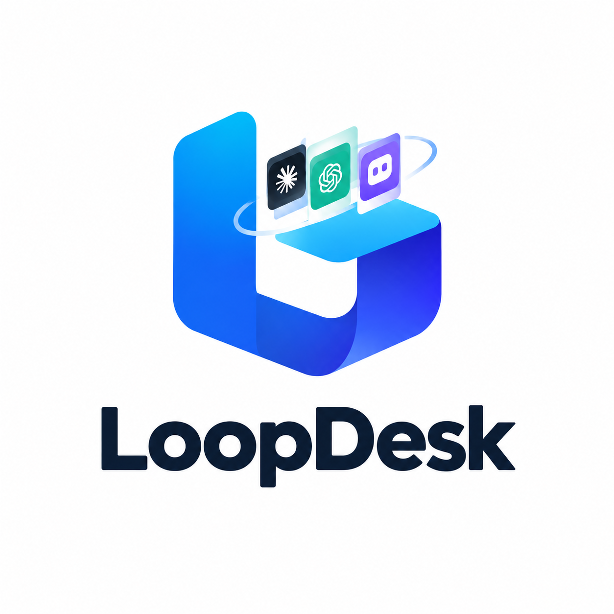

# LoopDesk — 本地优先的团队循环工作区

<p align="center">
  
</p>

<p align="center">
  <b>在任意 agent 里启动任务，换个 agent / 会话 / 成员就能直接续跑。</b><br>
  可移植的 durable loop state · git 原生的团队 AI 资产分发 · 零基础设施 local-first
</p>

<p align="center">
  <a href="LICENSE"></a>
  <a href="docs/prd/loopdesk-prd-v2.0.zh.md"></a>
  <a href="https://www.python.org/downloads/"></a>
</p>

---

> **本文档的定位**
> 本 README 是 **LoopDesk v2.0 的产品说明**，以 PRD v2.0 为准。
> 产品定位类表述发生冲突时，权威顺序为：① [`docs/product-positioning.md`](docs/product-positioning.md) → ② [`docs/prd/loopdesk-prd-v2.0.zh.md`](docs/prd/loopdesk-prd-v2.0.zh.md) → ③ [`docs/plans/loopdesk-webui-design-spec.md`](docs/plans/loopdesk-webui-design-spec.md) → ④ [`docs/design-system.md`](docs/design-system.md)。
> 各章节的实现进度以 PRD 的完成度图例（✅ 已实现 / 🔶 待验收 / ⏳ 已决策 / 🔲 待排期 / 🆕 新增设计）标注，本文不单独发明状态。

## 一句话定位

**LoopDesk 是一个 local-first 的团队循环工作区**——在开发者自有机器上统一编排 claude、codex、pi 等 agent 完成任务，通过跨 agent / 跨会话 / 跨团队的上下文传递，以及团队 AI 资产（Specs / Rules / Skills / MCP / 交付物）的 git 化分发，让团队像拥有一个"项目管理部"一样持续、可审计、可控地完成长任务。

> **Elevator Pitch**
> 在任意支持的 agent 中启动任务，不用复制粘贴完整上下文，即可在另一个 agent / 会话 / 成员处续跑；看到的是当前 loop state 与团队资产，而不是最新一条 chat message。

## 为什么需要 LoopDesk

研发团队的真实工作流天然分散：**任务**在 JIRA / Plane，**知识**在 Confluence，**编码**分散在 claude / codex / pi 等多个 agent。每个 agent 有独立会话与上下文，于是人变成了手动桥接层——重复解释需求、搬运上下文、重建决策。

同时，团队沉淀的 Specs / Rules / Skills / MCP / 交付物散落在各个成员的机器里，既无法复用，也无法治理。

LoopDesk 要消除的正是这两处摩擦：**上下文不该靠人搬运，团队能力不该锁在个人机器里。**

## 目标形态：一条任务的生命周期

```
安装 → loopdesk onboard → 连 JIRA / Confluence → 选 issue-fix 模板
  → LoopDesk 调度 claude 在隔离 worktree 中修复
  → quota / gate 把关（关键关口人工审批）
  → 回写 JIRA + 留下 run log + 产出 validation receipt
  → 换 codex 或另一位成员，从 durable state 直接续跑
```

对应 PRD §8.1 的八步主流程。各步的当前完成度见文末[项目状态](#项目状态与路线图)。

## 核心能力：九大平面

| 平面 | 职责 | 关键能力 |
| --- | --- | --- |
| **Workspace & State** | 单一真相源 | `LOOP-STATE.json`、团队级上下文、Handoff Packet、partial export/import、公私边界 |
| **System Integration (MCP)** | 外部系统接入 | JIRA / Plane / Confluence / GitHub 连接器、双向同步、MCP lifecycle |
| **Agent Orchestration** | local-first 编排 | Agent 注册表、Task Router、per-Goal worktree 隔离、并行 agent、状态 rollup |
| **Loop Engine & Long Tasks** | 长任务自动完成 | Scheduler、triage / maker / checker / escalation、长任务模板、quota / gate、typed handoff |
| **Context & Memory** | 上下文传递 | Context Injection Contract、跨会话 / 团队 continuity、三层记忆、白盒可编辑、compaction |
| **Team AI Assets** | 团队能力复用 | 资产注册表、git 共享、下发 Distributor、Skill Engineering |
| **Governance / Cost / Safety** | 治理与护栏 | Execution Trace、成本 rollup、预算 / kill switch、审批队列、沙箱、失败模式目录 |
| **Surfaces** | 用户面 | CLI、本地 Web 控制台（Codex 三栏）、Agent Work Feed、IM 继续面、guided onboarding |
| **Learning** | 持续改进 | Continuous Learning Loop、decision 谱系、reward 信号、friction 沉淀、KB Health |

> 完整能力清单（逐条 ID / 优先级 / 状态 / 借鉴来源）见 PRD [§9 功能清单](docs/prd/loopdesk-prd-v2.0.zh.md)。

## 四条护城河

竞品的连续性几乎都封在自家生态内——有的在 worktree，有的在自家 app，有的在自己终端或工作台。**没有一家提供跨外部工具（Claude Code ↔ Codex ↔ Trae ↔ Gemini）可导入导出的 durable loop state。** 这正是 LoopDesk 的立足点：

1. **可移植的 durable `LOOP-STATE.json`** —— 可机读、跨工具、可 diff / export。
2. **显式的 Loop Engineering 方法论** —— triage → maker → checker → escalation → run log → stop condition，外加 issue-fix / pr-commit / auto-research 固定长任务模板。
3. **零基础设施 local-first** —— 无服务器、无 DB、无云账号即可跑。
4. **git 原生的团队 AI 资产分发** —— 以代码仓库为分发底座，而非 Cloud 托管。

## 领域模型

```
团队 Team（可选；local-first 下的协作边界，经 git 仓库共享资产）
└─ 项目 Project（顶层空间容器，侧栏项目切换器）
   └─ 循环 Loop（1 项目 = 多 Loop，各自独立连续工作流；侧栏 Loop 切换器）
      └─ 目标 Goal（每 Loop 多个；各享 worktree 隔离 + Loop Engineering 六阶段）
         ├─ Run（Goal 的一次执行实例，含 trace / checkpoint / replay / validation receipt）
         └─ Handoff Packet（跨 agent / 会话 / 团队的上下文打包，下一执行方直接续跑）
      ↑ 新建任务 Task = 用户意图入口，创建 Goal 并自动进入当前活跃 Loop
```

- **Task（新建任务）**：用户侧意图入口。新建任务 = 在活跃 Loop 创建 Goal，必须归属项目与 Loop（缺省取当前）。
- **Goal**：Loop 内的 bounded 工作单元，走六阶段（分诊 → 制作 → 检查 → 升级 → 运行日志 → 停止）。
- **Loop**：项目内的连续工作流，跨多个 Goal 持续，持有连续上下文（memory / artifacts / run log）。
- **Handoff Packet**：跨 agent / 会话 / 团队的上下文契约，MUST typed、可 diff、可部分导出。

> **命名纪律**：统一使用 LoopDesk / `loop_workspace` / `LOOP-STATE.json` / Project / Loop / Goal / Task / Run / Handoff Packet；**不**在公开面暴露 legacy `session`、`workspace-state.json` 或 channel-first 文案。

## 界面：Codex 三栏范式

前端刻意采用程序员已经熟悉的心智（Codex 三栏 + 设置对话框），**零学习成本**：

```
┌───────────────┬───────────────────────────────┬──────────────────────┐
│  左栏 导航     │  中栏 主工作区                 │  右栏 上下文(可折叠)   │
│  240px        │                               │  360px               │
│               │  顶部：项目名 · 搜索 · +新建    │                      │
│ ▾ 项目切换器   │                               │  当前任务概览         │
│               │  ┌── 任务看板（默认落地）──┐   │  ├ 进度（简化/六阶段） │
│ 任务           │  │ 待办│进行中│评审中│完成 │   │  ├ 成本 / 预算        │
│  · 待办 3      │  │ ┌──┐┌──┐┌──┐┌──┐      │   │  ├ 审批门             │
│  · 进行中 2    │  │ │卡││卡││卡││卡│      │   │  ├ 变更 diff          │
│  · 评审中 1    │  │ └──┘└──┘└──┘└──┘      │   │  ├ Agent / 会话       │
│  · 已完成 12   │  └────────────────────────┘   │  └ 证据 / 验证 ▸      │
│               │                               │                      │
│ 资产市场 🛍     │                               │                      │
│ 设置 ⚙         │                               │                      │
└───────────────┴───────────────────────────────┴──────────────────────┘
```

三条设计原则：

- **三栏恒定**：无论用户多专业，主界面始终是三栏；专业能力通过右栏 / 设置渐进披露，不新增顶层页面。
- **任务为中心**：默认落地任务看板，按项目切换；Loop / Goal 是后端边界，前端不拆页。
- **术语分层**：一级界面只说人话（任务 / 看板 / 对话 / 变更 / 成本 / 审批）；`Loop` / `Goal` / `Quota` / `Gate` / `Handoff` / `Validation Receipt` 等术语下沉到右栏、详情与设置，按需展开。

> **专业性不靠术语堆砌，而靠可见护栏**：审批队列、预算条、变更 diff、验证徽标、运行日志——看得见，才控得住、信得过。
>
> 看板第三列口径为 **评审中**，不叫"待审批"。**审批门（operator gate）不是一列**，而是卡在该状态里的动作，落在右栏三级折叠区块。
>
> 三栏规格、40 个 UI 组件的完整清单见 PRD [§9.11](docs/prd/loopdesk-prd-v2.0.zh.md)；视觉与交互契约见 [WebUI 设计规格](docs/plans/loopdesk-webui-design-spec.md)。

## 长任务模板

把"经验"固化成可参数化选用的骨架——选模板 → 填参 → 运行：

| 模板 | 用途 |
| --- | --- |
| **issue-fix** | 滚动仓库上下文 + 带版本修复知识，完成一个 issue 的定位、修复与验证 |
| **pr-commit** | 生成 / 打磨 PR 与提交信息，产出可评审的变更集 |
| **auto-research** | proposer → executor → evaluator 多角色迭代，输出可复用的研究结论 |

每个模板的运行都受 **quota / gate 治理**与 **stop condition** 约束，并留下可审计的 run log。

## 治理与安全护栏

LoopDesk 面向"无人值守的长任务"，因此护栏是一等公民而非附加项：

- **Quota 决策 `should-run`** —— 运行前先判定这一轮该不该跑。
- **五级 Gate** —— health → operator → evidence → focus → compute quota 决策链；关键关口交人审批。
- **显式预算** —— 预算上限、日限额、max iterations、kill switch；预算 80% 切 report-only 模式。
- **独立验证** —— checker 以 fresh context 运行、只读或限定 worktree 内、可对 workspace 快照做哈希校验；Goal 完成 MUST 产出机器可读 `validation receipt`（**checker ≠ maker**，integrity = clean）。
- **隔离** —— per-Goal worktree / scratch 目录，避免 cross-loop workspace 污染；remote surface 不得绕过本地隔离与安全控制。
- **审计与边界** —— deny-wins 工具策略、path denylist、secrets 不进 prompt / state / logs、公私边界（私有日志与活跃 goal 状态不提交）。
- **失败模式目录** —— Infinite Fix Loop / State Rot / Verifier Theater / Token Burn / Secrets Leakage 等 11 类，各有检测信号与 kill / 降级规则。

> 运营规则示例：连续 2 周 cost > value 则 kill loop；CI red 或关键 reviewer 不在时暂停 loop。

## 边界：LoopDesk 不做什么

范围护栏与能力同等重要：

| 不采纳 | 理由 |
| --- | --- |
| 强实时云房间 / 多人同时编辑 | 坚持 local-first，团队共享改走 git 异步资产 |
| 取代 claude / codex / pi 等 agent runtime | LoopDesk 是**控制 / 编排层**，不是 runtime |
| 重桌面 GUI / Electron IDE 壳 | 连续性应当 portable，不做重壳 |
| 中心化多租户 SaaS | 团队共享以 git 仓库为底座，云仅作可选同步 |
| 团队额度 SaaS 计费 | 参照竞品仅预留接口，不作 v2.0 核心 |
| peer claim 取代 maker / checker | 保留显式独立验证语义 |
| 22 平台配置文件生成 | 用运行时协议（MCP / ACP）替代生成式适配 |

> 完整清单见 PRD [§3.3 明确不采纳清单](docs/prd/loopdesk-prd-v2.0.zh.md)。

## 架构总览

LoopDesk 把"管任务"与"干活"分开：

| 层 | 角色 | 说明 |
| --- | --- | --- |
| **控制 / 编排层** | LoopDesk | `LOOP-STATE.json` 单一真相源、Loop 引擎、quota / gate、审批、成本、资产分发、跨工具 handoff |
| **运行时层** | claude / codex / pi 等 | 各自保留原生会话与 runtime；LoopDesk 只调度与交接，不重写它们的执行语义 |

两层之间通过 **MCP-first、ACP-second** 的适配层连接。这也是"不取代 runtime"这条边界的落地方式。

## 文档地图

**定位与需求**

- [`docs/product-positioning.md`](docs/product-positioning.md) —— 产品定位唯一权威
- [`docs/prd/loopdesk-prd-v2.0.zh.md`](docs/prd/loopdesk-prd-v2.0.zh.md) —— **当前权威 PRD**（九大平面能力清单 + Codex 三栏前端清单）
- [`docs/plans/loopdesk-webui-design-spec.md`](docs/plans/loopdesk-webui-design-spec.md) —— WebUI 设计规格 v2.0
- [`docs/design-system.md`](docs/design-system.md) —— 设计 token 唯一事实源

**用户文档**

- [`docs/README.md`](docs/README.md) —— 文档总索引
- [`docs/web-ui.md`](docs/web-ui.md) —— 本地控制台（Codex 三栏）
- [`docs/glossary.md`](docs/glossary.md) —— 术语表（中文为主，含循环工程术语）

**实现现状**

- [`docs/design-system/frontend-vs-prd-audit.md`](docs/design-system/frontend-vs-prd-audit.md) —— 前端实现 ⇄ PRD 的逐项核对与偏差
- [`docs/design-system/prd-vs-design-draft-deviations.md`](docs/design-system/prd-vs-design-draft-deviations.md) —— PRD ⇄ 设计稿偏差清单

**协作规范**

- [`AGENTS.md`](AGENTS.md) —— 项目级 agent 规则（定位权威顺序、Golden Rules、防漂移锚点）

## 项目状态与路线图

**已落地的基线**（v0.1 / v1.x 继承）

- `LOOP-STATE.json` 与 `loop_workspace` 状态内核；memory / skills / artifacts / worktree 同一边界
- 本地 gateway 与 CLI；本地 Web 控制台
- MCP-first 适配层；Loop 引擎（triage / maker / checker / run log / stop condition）
- 成本跟踪、审批队列、沙箱与隔离
- **任务看板已前后端打通**：本地 Web 控制台的任务看板经网关 API（`GET/POST /api/v1/projects/{id}/tasks`、`PATCH /api/v1/tasks/{id}`、`POST /api/v1/tasks/{id}/gate/decision`）与 SSE（`/api/v1/events`）双向联动；网关不可用时优雅降级为画布种子数据

**v2.0 核心（设计已完成，实现待排期 🆕）**

- MCP 默认连接器：JIRA / Plane / Confluence / GitHub 双向同步
- Agent Orchestrator：agent 注册表 + Task Router + 并行 / 子会话
- 团队级 Workspace State 与跨成员 **Handoff Packet**
- 团队 AI 资产注册表 + git 原生分发（Rules / Specs / Skills 一键下发与回滚）
- 长任务模板（issue-fix / pr-commit / auto-research）+ quota / gate
- 独立验证凭证（validation receipt）

**路线图**

| 阶段 | 内容 |
| --- | --- |
| v0.1 ✅ | 个人循环工作区：`LOOP-STATE.json`、MCP-first、loop engine、memory、skills、artifacts、cost / safety、worktree 隔离、CLI + 本地 Web |
| v0.2 🔶 | 可选 IM channel adapters、Web inspection 扩展 |
| v1.1 / v1.2 🔶 | handoff CLI、guided handoff、Human Model、intent / planner、trace schema、task router |
| **v2.0（本版目标）** | 团队循环工作区：系统集成、Agent Orchestrator、团队级上下文 + Handoff Packet、资产 git 分发、长任务模板 + quota / gate、独立验证 |
| v2.x | 团队额度管理、Goal 时间线视图、Agent Work Feed、三层记忆 + Memory Dream、hash-chain 审计、桌面打包、机器可读文档 |
| v3.x | 跨团队资产 network、模板市场、可选实时共享形态、runtime driver 抽象 |

**成功指标（节选）**

| 指标 | 目标 |
| --- | --- |
| Context re-entry time（跨工具 / 成员切换后重新解释上下文的时间） | ≤ 手动 handoff 的 30% |
| Loop completion rate（Goal 达到 stop condition 的比例） | ≥ 80% |
| 跨团队成员交接成功率 | ≥ 85% |
| 独立验证可信度（checker ≠ maker 且 integrity = clean） | ≥ 95% |
| 首次 setup 在 5 分钟内完成 | ≥ 70% |

> 完整指标、失败模式目录与 Launch Criteria 见 PRD §12 / §13 / §14。

## 参与贡献

欢迎任何形式的贡献——缺陷报告、功能建议、文档、连接器适配、skills 与核心工作。请先阅读 [`CONTRIBUTING.md`](CONTRIBUTING.md)，然后在 [GitHub](https://github.com/JustinIan-AI/Savus) 上提交 issue 或 pull request。

## 许可

[Apache License 2.0](LICENSE) · [行为准则](CODE_OF_CONDUCT.md) · [安全策略](SECURITY.md) · [支持](SUPPORT.md) · [第三方声明](THIRD_PARTY_NOTICES.md)
