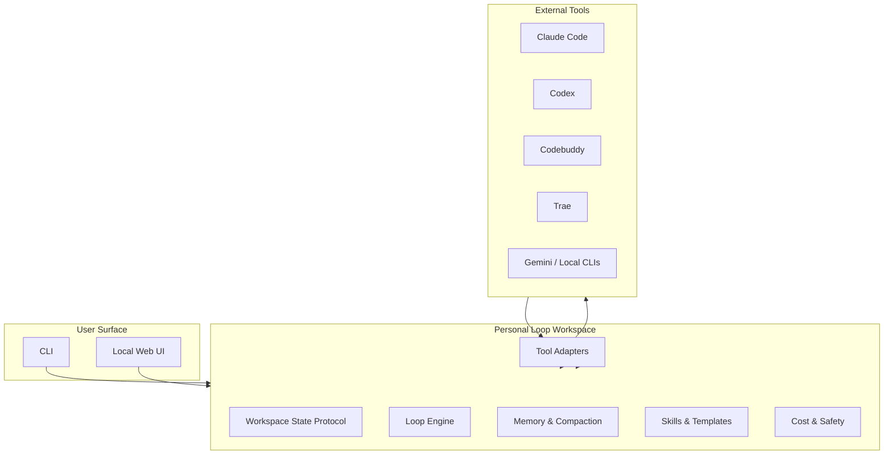
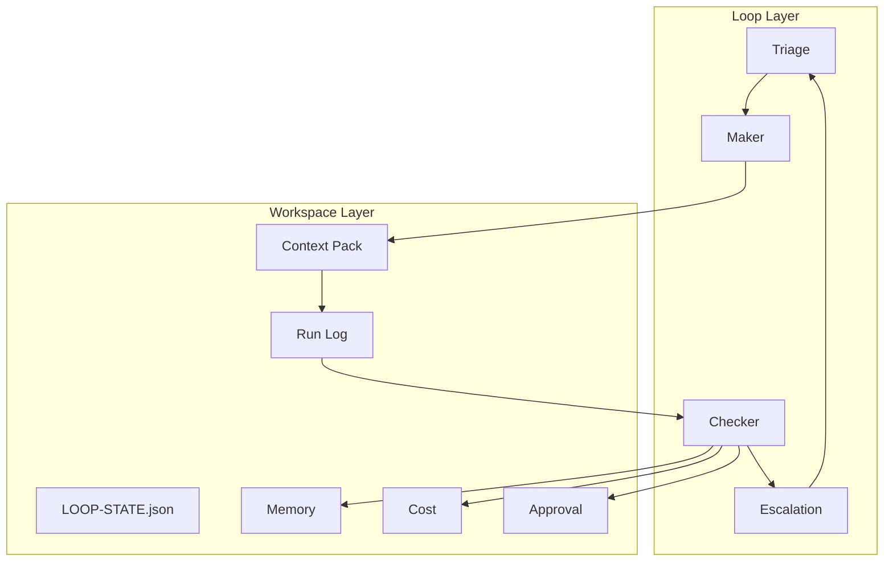

# LoopDesk Product Guide

LoopDesk is a local-first personal loop workspace for independent developers.
It keeps `LOOP-STATE.json`, memory, skills, artifacts, approvals, and tool
context coherent across Claude Code, Codex, Codebuddy, Trae, Gemini, and local
CLIs, while keeping automation safe through Loop/Goal boundaries, approvals,
budgets, and worktree isolation.

This guide is the product and usage entry point. The existing
[`README.md`](README.md) remains the package/release README.

## Start Here

1. Install LoopDesk:

   ```sh
   uv tool install --python 3.12 "loopdesk[recommended] @ https://github.com/loopdesk/loopdesk/releases/download/v0.3.1/loopdesk-0.3.1-py3-none-any.whl"
   ```

2. Configure your provider:

   ```sh
   loopdesk onboard
   ```

3. Start the gateway:

   ```sh
   loopdesk gateway run
   ```

4. Open the control UI:

   <http://127.0.0.1:18791/control/>

For platform-specific install paths and recovery steps, see
[`docs/quickstart.md`](docs/quickstart.md).

## Personal Loop Workspace Positioning

For independent developers who move between Claude Code, Codex, Codebuddy, Trae,
Gemini, and local terminals, LoopDesk is a local personal loop workspace that
unifies context, memory, loop state, and control across tools.

It is not another AI IDE. It is not another terminal agent wrapper. It is not a
team collaboration suite. It is the personal operating layer that remembers what
each tool knows, decides what should run next, and prevents the developer from
becoming the manual bridge between agents.

Competitive fit:
- Unlike Tutti-style shared agent workspaces, LoopDesk stays local-first and
  minimal for one developer.
- Unlike WeSight-style desktop agent workstations, it does not become another
  GUI shell around terminal agents.
- Unlike Multica-style team agent platforms, it does not require team workspaces,
  issue boards, or cloud sharing.

Core promise: start a task in one tool, continue it in another without
re-pasting context, project rules, or decisions.

## Why LoopDesk

LoopDesk focuses on cost-per-success and long-running usefulness rather than
single-turn chat alone.

| Product capability | What users get |
| --- | --- |
| Workspace State Protocol | One portable workspace layer for Loop/Goal state, decisions, memory, skills, and artifacts. |
| Loop Engine | Repeatable discovery loops with triage, bounded Goal execution, maker/checker split, stop conditions, and run logs. |
| Session and memory continuity | Durable memory, long-session compaction, history, replay, and cross-session recall. |
| Cross-tool adapters | Connect Claude Code, Codex, Codebuddy, Trae, Gemini, and local CLIs without forcing one vendor UI. |
| Personal workflow templates | Reusable product-manager, architect, backend, frontend, and quality workflows. |
| Local runtime control | CLI, Web UI, approvals, permissions, worktree isolation, and local observability. |
| Safe tool use | High-risk goals run in isolated worktrees with approval, budget, kill switch, and denylist gates. |

## Complete Product Architecture

Read the architecture narrative and diagrams in
[`docs/architecture/personal-loop-workspace.md`](docs/architecture/personal-loop-workspace.md).





## Documentation Map

| Need | Read |
| --- | --- |
| Install and run LoopDesk | [`docs/quickstart.md`](docs/quickstart.md) |
| Read the architecture diagrams | [`docs/architecture/personal-loop-workspace.md`](docs/architecture/personal-loop-workspace.md) |
| Read the product positioning | [`docs/product-positioning.md`](docs/product-positioning.md) |
| Read the core feature list | [`docs/features/core-feature-list.md`](docs/features/core-feature-list.md) |
| Read competitive analysis | [`docs/research/competitive-intel.md`](docs/research/competitive-intel.md) |
| Read competitor deep dive | [`docs/research/competitive-intel-stablyai-orca.md`](docs/research/competitive-intel-stablyai-orca.md) |
| Read Octos deep dive | [`docs/research/competitive-intel-octos.md`](docs/research/competitive-intel-octos.md) |
| Read Octos overview | [`docs/research/octos-overview.md`](docs/research/octos-overview.md) |
| Read Proma inspiration | [`docs/research/proma-inspiration.md`](docs/research/proma-inspiration.md) |
| Choose the right workflow for a goal | [`docs/use-cases.md`](docs/use-cases.md) |
| Start, stop, expose, or troubleshoot the gateway | [`docs/gateway.md`](docs/gateway.md) |
| Configure providers, permissions, and local loop settings | [`docs/configuration.md`](docs/configuration.md) |
| Learn the LoopDesk CLI command groups | [`docs/cli.md`](docs/cli.md) |
| Use the local LoopDesk console | [`docs/web-ui.md`](docs/web-ui.md) |
| Work with memory and compaction | [`docs/features/memory.md`](docs/features/memory.md) |
| Work with skills and templates | [`docs/features/skills.md`](docs/features/skills.md) |
| Inspect usage and model cost | [`docs/usage-and-cost.md`](docs/usage-and-cost.md) |
| Diagnose and inspect loop history | [`docs/diagnostics-and-replay.md`](docs/diagnostics-and-replay.md) |
| Connect MCP-capable clients | [`docs/mcp-server.md`](docs/mcp-server.md) |
| Fix common install/runtime problems | [`docs/troubleshooting.md`](docs/troubleshooting.md) |
| Read the v1.1 launch completion plan | [`docs/plans/2026-07-28-loopdesk-v11-launch-completion-fdd-tdd.md`](docs/plans/2026-07-28-loopdesk-v11-launch-completion-fdd-tdd.md) |
| Review the first completed `opensquilla` → `loopdesk` batch rename decision | [`docs/decisions/full-package-rename.md`](docs/decisions/full-package-rename.md) |
| Read the v1.1 guided handoff guide | [`docs/guides/guided-handoff.md`](docs/guides/guided-handoff.md) |
| Understand LoopDesk terminology | [`docs/glossary.md`](docs/glossary.md) |

## The Fastest Useful Workflow

After the gateway is running, use the surface that fits the job:

```sh
loopdesk chat
```

Use this for interactive terminal work.

```sh
loopdesk agent -m "Summarize this repo and tell me what to test"
```

Use this for one-shot automation.

```sh
loopdesk gateway start --json
```

Use this for background Web UI, RPC, and local tool bridges.

```sh
loopdesk sessions list
loopdesk cost
loopdesk doctor
```

Use these to inspect gateway readiness and cost.

## Configuration Essentials

LoopDesk local runtime configuration order:

1. `LOOPDESK_GATEWAY_CONFIG_PATH`
2. `./loopdesk.toml`
3. `~/.loopdesk/config.toml`
4. built-in defaults

Use the CLI for routine changes:

```sh
loopdesk onboard --if-needed
loopdesk configure provider --provider openrouter --api-key-env OPENROUTER_API_KEY
loopdesk configure router --router recommended
loopdesk configure search --search-provider brave --api-key-env BRAVE_SEARCH_API_KEY
loopdesk config get llm.provider
loopdesk config set gateway.port 18791
```

See [`docs/configuration.md`](docs/configuration.md) for details.

## Feature Highlights

### Workspace State Protocol

The workspace is the product boundary. `LOOP-STATE.json`, memory, skills,
artifacts, and workspace files act as the portable source of truth so tools can
start where the last one left off.

Read: [`docs/architecture/personal-loop-workspace.md`](docs/architecture/personal-loop-workspace.md)

### Cross-Tool Adapters

External tools connect through MCP-first adapters with ACP support where
available. Adapter events translate loop state, memory, permission, approval,
budget, and tool-call semantics between tools such as Claude Code, Codex,
Codebuddy, Trae, Gemini, and local CLIs.

Read: [`docs/features/core-feature-list.md`](docs/features/core-feature-list.md)

### Loop Engine

Loops run triage, bounded Goal execution, maker/checker split, escalation, and
stop conditions with explicit state, budgets, and approval gates. This keeps
the developer in control while automating repeatable work safely.

Read: [`docs/architecture/personal-loop-workspace.md`](docs/architecture/personal-loop-workspace.md)

### Personal Workflow Templates

Built-in templates encode product, architecture, backend, frontend, and quality
workflows so loops do not rederive the same judgment every run. Templates are
personal and inspectable; they do not impose team roles or governance.

Read: [`docs/features/skills.md`](docs/features/skills.md)

## Safety Defaults

The gateway binds to `127.0.0.1` by default. Binding to public interfaces is
opt-in:

```sh
loopdesk gateway run --listen 0.0.0.0 --port 18791
```

Do not expose a public gateway without token auth and a network boundary you
trust. For tool behavior, approval flow, and workspace containment, see
[`docs/tools-and-sandbox.md`](docs/tools-and-sandbox.md).

## Existing Reference Docs

- [`README.md`](README.md) - release/package README
- [`MIGRATION.md`](MIGRATION.md) - migration from OpenClaw and Hermes Agent
- [`docs/features/meta-skill-user-guide.md`](docs/features/meta-skill-user-guide.md) - MetaSkill user guide
- [`docs/authoring/meta-skills.md`](docs/authoring/meta-skills.md) - MetaSkill authoring guide
- [`CONTRIBUTING.md`](CONTRIBUTING.md) - contributor workflow
- [`CHANGELOG.md`](CHANGELOG.md) - release history

## Improve the Documentation

LoopDesk documentation is part of the product. If a setup step is confusing,
a command is stale, or a feature guide needs a clearer example, open a small
pull request against `dev`.

Read [`docs/contributing-docs.md`](docs/contributing-docs.md) for docs-specific
guidance.
