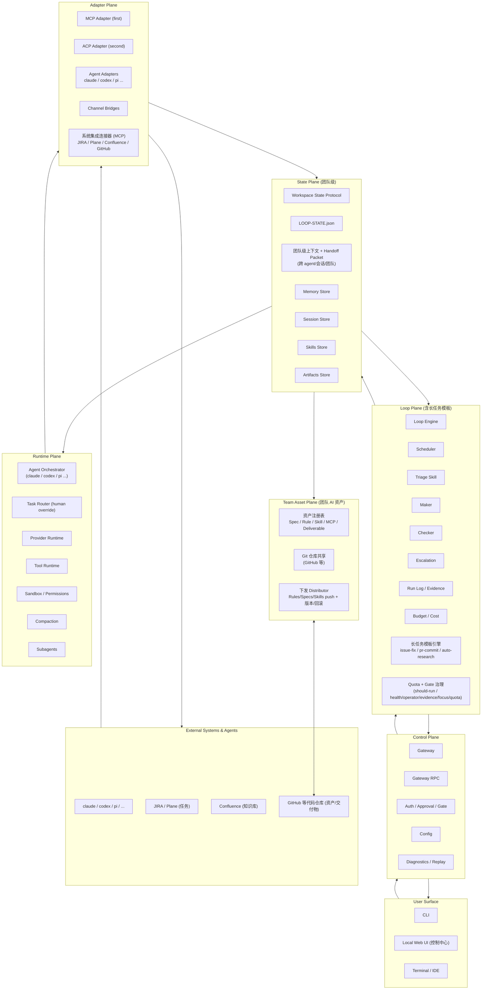

# LoopDesk 团队循环工作区架构（Team Loop Workspace Architecture）

> Version: v0.2（团队开发视角，承接 v0.1 个人循环工作区）
> Last updated: 2026-09-11
> 关联 PRD：docs/prd/personal-loop-workspace.md(v0.2)
> 竞争参照：tutti-os/tutti（实时多代理协作）、huangruiteng/loopx（长程控制平面 / peer agent teams）、proma-ai/proma（企业版 Skills 分发）

本架构在 v0.1（个人、local-first、跨工具连续性）基础上，引入**团队开发**能力：MCP 系统集成、local-first agent 编排、跨 agent/会话/团队上下文传递、git 化团队 AI 资产分发、LoopX 式长任务模板。坚持 local-first 与 adapter-first，不与 Tutti 抢"强实时云房间"，不与 LoopX 抢"控制平面内核"的纯个人形态，而是把两者优势收敛到团队工作区。

## Architecture Overview



## Layer Descriptions

### User Surface
- CLI、本地 Web UI（控制中心）、Terminal/IDE。轻量、团队可用但不做成重协作套件。
- 控制中心统一展示：所有 agent 会话、待审批操作、运行任务、团队资产状态、长任务进度。

### Control Plane
- Gateway、RPC、Auth、Config、Diagnostics。
- 强化 **Gate / Approval**：敏感动作、生产操作、发布需人审批（对应 LoopX operator gate）。

### Loop Plane（含长任务模板）
- Scheduler、triage、maker、checker、escalation、run log、budget 沿用 v0.1 的 loop 工程方法（L1 报告 → L2 辅助 → L3 无人值守）。
- 新增 **长任务模板引擎**：内置 issue-fix / pr-commit / auto-research 固定骨架，参数化选用。
- 新增 **Quota + Gate 治理**：`should-run` 决策链（health→operator→evidence→focus→quota）、typed turn 结果枚举、typed handoff；关键关口需人审批，安全回退可继续但不绕过 gate。

### State Plane（团队级）
- Workspace State Protocol 仍为单一真相源，扩展为**团队级上下文**：目标、决策、证据、待办、交接、配额。
- 新增 **Handoff Packet**：跨 agent / 跨会话 / 跨团队的上下文打包，下一执行方可直接续跑，无需人重复解释。
- 持久化 `LOOP-STATE.json`、Memory、Sessions、Skills、Artifacts，并支持 cross-team 引用（经 git 资产输入）。

### Team Asset Plane（团队 AI 资产）
- **资产注册表**：Spec / Rule / Skill / MCP / Deliverable 五类，统一建模、可版本化、可审计。
- **Git 同步**：资产以代码仓库内文件形式共享（clone/pull/push），local-first 底座。
- **下发 Distributor**：Rules / Specs / Skills 由 owner/管理员一键 push 到成员工作区，免安装、版本统一、可回滚；MCP 配置与交付物随仓库共享但不强制下发。
- 与 Proma 企业版 Skills 分发的差异：LoopDesk 以 **git 原生**为底座（而非 Cloud 托管），更贴合研发团队既有工作流。

### Runtime Plane
- **Agent Orchestrator**：注册并 local-first 调度 claude / codex / pi 等 agent；维护 agent 注册表（provider/runtime/指令/env/MCP/Skills/并发）。
- Task Router 保留 human override，不允许无界自动路由。
- Provider/Tool runtime、Sandbox、Compaction、Subagents 沿用 v0.1，执行本地、成本感知、安全。

### Adapter Plane
- **MCP-first**：工具、资源、prompt、事件统一建模；ACP 用于 session-rich 工具。
- **Agent Adapters**：claude / codex / pi 等，把外部 agent runtime 接入编排层。
- **系统集成连接器（MCP）**：JIRA / Plane（任务双向同步）、Confluence（知识检索）、GitHub（资产/交付物共享）。连接器以 MCP Server 插拔扩展。

## Data Flow（团队长任务示例：issue-fix）

```mermaid
sequenceDiagram
  participant U as Team/Owner
  participant UI as Web UI/CLI
  participant Tpl as 长任务模板(issue-fix)
  participant Loop as Loop Engine + QuotaGate
  participant State as Workspace State(团队级)
  participant Asset as 团队资产(Distributor)
  participant Orch as Agent Orchestrator
  participant MCP as 连接器(JIRA/Confluence)
  participant A as claude/codex/pi

  U->>UI: 选 issue-fix 模板 + 填参(issue链接/仓库)
  UI->>MCP: 拉取 JIRA issue + Confluence 相关知识
  MCP->>State: 写入任务上下文 + 知识引用
  UI->>Asset: 下发适用 Rule/Skill 到本工作区
  UI->>Tpl: 生成 Goal 骨架
  Tpl->>Loop: 提交 Goal + 预算
  Loop->>Loop: quota should-run? → gate 决策链
  Loop->>Orch: 调度 claude 做修复(隔离 worktree)
  Orch->>A: 执行 + 工具调用
  A->>State: 写会话/证据/交付物
  Loop->>Loop: maker/checker + stop condition
  Loop->>MCP: 回写 JIRA 进度/PR 链接
  Loop->>UI: 报告结果 + run log + 下一建议
```

## Key Design Decisions（关键设计决策）

- **Local-first + 团队**：核心运行时/状态在本地；团队共享以 git 仓库为底座（异步、可版本、可审计），不强依赖实时云房间（区别于 Tutti）。
- **Workspace/Asset 为真相源**：团队可 inspect、diff、backup、handoff，无需专属云账号。
- **MCP first, ACP second**：MCP 覆盖最广工具面；系统集成（JIRA/Plane/Confluence/GitHub）亦以 MCP 连接器实现，可插拔。
- **Loop 工程即产品行为**：围绕 loop/template 组织，而非 chat；长任务内置 issue-fix/pr-commit/auto-research 模板。
- **LoopX 式治理**：quota/gate/typed-handoff 保证长任务可审计、可重启、可交接——直接对标 LoopX 已验证的 200h 实践。
- **团队资产 git 原生分发**：Rules/Specs/Skills 下发经 git 仓库，差异化于 Proma 的 Cloud 托管分发。

## Competitive Architecture Notes（竞争架构注解）

- **vs Tutti**：Tutti 强在实时多用户多代理共享工作区 + Big @ + 代理借用 + 房间隔离。LoopDesk 保留"跨代理上下文复用 + 代理协作"收益，但把共享底座换成 **local-first + git 异步资产**，不强制强实时云房间，避免 IM/云依赖。
- **vs LoopX**：LoopX 强在长程控制平面 + peer agent teams + quota/gate + typed handoff。LoopDesk 直接引入其 quota/gate/typed-handoff 与 issue-fix/auto-research 模板范式，并叠加"团队 AI 资产 git 分发"与"JIRA/Plane/Confluence 接入"以贴合研发团队真实工作流。
- **vs Proma**：Proma 企业版强在团队额度 + Skills 组织级分发 + Cloud API Key。LoopDesk 以 **git 原生资产分发 + 本地编排**差异化，避免绑定 Cloud 计费。
- **vs WeSight / Multica**：沿用 v0.1 取舍——借 runtime 可见性与 adapter 统一，避免 GUI 壳膨胀与团队治理复杂度（面向 solo 时的 Non-Goals 在团队视角下仅放开"资产/上下文/模板"，仍不做重协作套件）。
