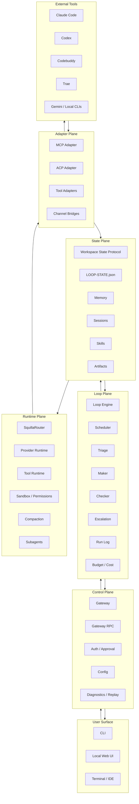

# Product Strategy — Personal Loop Workspace for Independent Developers

> Status: ready for review
> Last updated: 2026-07-16
> Owner: product/engineering
> Inputs: competitive review of Tutti, WeSight, Multica, Orca, Proma; internal positioning; architecture; core feature list; external methodology review of `cobusgreyling/loop-engineering`; Desktop/Web/IM boundary decision; v1.0 PRD.

> Methodology anchor: `docs/research/loop-engineering.md`. This strategy treats LoopDesk as a local-first personal loop workspace that borrows Loop Engineering as operating discipline, not as a direct GitHub/CI/team template.

## 1. Executive Summary

We are building a **local personal loop workspace** for independent developers who move between Claude Code, Codex, Codebuddy, Trae, Gemini, and local terminals.

The product is **not another AI IDE**, **not another terminal agent wrapper**, and **not a team collaboration suite**.

It is the **personal operating layer** that remembers what each tool knows, decides what should run next, and prevents the developer from becoming the manual bridge between agents.

## 2. Target User

Primary user: **independent developer**.

Characteristics:
- works alone or with a small number of AI tools
- switches between multiple coding agents and terminals in one project
- wants continuity across sessions, machines, and tool vendors
- cares about cost, control, privacy, and portability
- does not want mandatory cloud accounts, team onboarding, or heavy GUI workflows

## 3. Problem Statement

Independent developers face four recurring problems today:

- **Context re-entry cost**: every new session in Claude Code, Codex, Trae, or Gemini starts cold; the developer re-explains the project, decisions, and prior output.
- **Tool silo tax**: useful output from one agent stays trapped in that agent's chat; moving it to the next tool requires copy, paste, upload, and re-explanation.
- **No persistent loop memory**: preferences, conventions, reusable artifacts, failed attempts, and task state are not preserved in one portable workspace.
- **Unsafe automation growth**: as developers add cron, scripts, skills, and subagents, cost, permissions, approvals, and failure recovery become harder to control.

## 4. Competitive Landscape

| Competitor | Strength | Over-reach | Gap we exploit |
| --- | --- | --- | --- |
| Tutti | shared agent workspace, cross-agent handoff | cloud rooms, collaboration breadth | solo local-first minimal loop |
| WeSight | desktop runtime visibility, multi-engine GUI | GUI shell, IM breadth | lightweight context layer |
| Multica | team task management, runtime daemon, autopilot | team governance, issue board, cloud sharing | personal loop state and continuity |
| Orca | parallel worktrees, rich terminal UX, diff/PR/Linear review | IDE-shell-first product | portable cross-tool context handoff and loop engineering |
| Proma | local-first Chat/Agent workbench, workspace Skills/MCP, remote bot bridges | desktop-shell-first Chat/Agent workflow | durable cross-tool loop state and cross-tool continuity |

Our differentiation:
- **continuity first**
- **tool-agnostic loop**
- **local control**
- **loop engineering discipline**

## 5. Product Vision

A developer can:
- start work in one AI tool
- continue it in another without re-pasting context
- inspect the current loop state in one place
- let the system suggest the next tool or step
- keep sessions, decisions, artifacts, and errors searchable and portable

The workspace is the source of truth. The tools are interchangeable execution surfaces.

## 6. Core Product Principles

- **Local-first runtime**: primary execution and state live on the developer's machine.
- **Workspace as source of truth**: `LOOP-STATE.json`, memory, skills, artifacts, and workspace files are inspectable, diffable, and portable.
- **MCP first, ACP second**: MCP covers the broadest integration surface; ACP is used for session-rich tools that support it.
- **Loop engineering as product behavior**: design loops that discover work, run bounded goals, verify outcomes, and persist state; default to L1/L2 before L3.
- **Skills as reusable judgment**: encode conventions, review standards, and workflow templates so the loop does not rederive intent every run.
- **Human gate by default**: loops should escalate on ambiguity, repeated failure, high risk, and denylist paths instead of auto-merging or auto-fixing blindly.
- **Minimal viable surface**: desktop-first CLI + local control UI first; avoid premature multi-user, IM-first, and heavy desktop-app complexity.
- **Desktop-first tri-surface narrative**: Desktop runtime owns authority and richest inspection; Web supports distribution, setup, inspection, approval, and diagnostics; IM remains an optional, disabled-by-default continuation surface for approved workspace work.
- **Proma-style extensibility, not shell replication**: adopt workspace-scoped Skills/MCP and bounded remote bot signals without turning LoopDesk into a desktop Chat/Agent shell.

## 7. Product Architecture

See `docs/architecture/personal-loop-workspace.md` for detailed layer descriptions and data flow.

> Surface boundary anchor: `docs/decisions/desktop-web-im-product-boundary.md`. v1.0 makes the tri-surface priority explicit: Desktop runtime is primary; Web is secondary; IM is tertiary.

## 8. Core Capabilities
### 8.1 Backend Boundary: Loop vs Goal
- **Loop**：后台持续发现工作、分类优先级、维护连续视角；它不直接改代码，而是决定“下一步做什么”。
- **Goal**：后台完成有边界、可验证的具体任务，经过 maker/checker 验证，达到 stop condition 后停止；Goal 是 Loop 的产物和执行单元。
- LoopDesk 采用 **Loop/Goal 分离模型**：两者是后端职责边界，不是前端必须拆成两套独立操作流。
- LoopDesk 借鉴 `docs/research/loop-engineering.md` 的成熟度模型，但限定为个人开发工作台版本：**L1 以 triage/state 为主，L2 才加入本地工具与 bounded goal 执行，L3 才允许更长自动化链**；不默认继承 GitHub/CI/PR 叙事。
- 对个人开发者而言，不管是发现 bug、需求、架构问题还是改进项，一旦问题收敛，系统应默认自动进入 Goal 执行，而不是要求用户手动切换模式。

### 8.2 Cross-Tool Adapter Layer
- MCP-first integration for tools, resources, prompts, and tool results.
- ACP integration for tools that support session lifecycle and streaming updates.
- Tool-specific adapters for Claude Code, Codex, Codebuddy, Trae, Gemini, and local CLIs.
- Inbound/outbound translation so external tool events become workspace state, and workspace state becomes tool-ready input.

### 8.3 Loop Engine
- Local loop scheduling and fire-immediately controls for personal triage; keep cron as an internal runtime capability only and do not expose it as a v0.1 user-facing channel.
- Triage skill that classifies work as act, propose, or escalate.
- Maker/checker split so implementation and verification are separated.
- `/goal`-style stop condition and explicit completion criteria.
- Run log records started, items found, actions taken, escalations, and cost.

### 8.4 Personal Memory and Session Continuity
- Durable memory with local keyword and semantic search.
- Workspace continuity and cache compaction for long-running personal work.
- Workspace resume, history, export, replay, and abort controls for loop state continuity.
- Workspace-to-memory flush so completed work becomes reusable knowledge.

### 8.5 Skill and Meta-Skill Runtime
- Reusable skills encode conventions, commands, review standards, and domain knowledge.
- Meta-skills package repeatable multi-step workflows.
- Replay, audit, and proposal surfaces for high-trust automation.

### 8.6 Runtime Visibility and Local Control
- Desktop app or packaged runtime for the richest loop workspace state, approvals, logs, memory, skills, diagnostics, and health.
- Local Web UI for setup, workspace inspection, approval decisions, diagnostics, replay, and export.
- Runtime state view for active runs, recent tool activity, pending approvals, and errors.
- Permission modes: read-only, restricted, full-access.
- Workspace containment with strict path controls and sandbox posture.

### 8.7 Cost Observatory and Safety Guard
- Token and cost tracking by loop, goal, skill, and local tool event.
- Budget caps, daily limits, kill switch, max iterations.
- Approval queue for sensitive tool calls, writes, and external actions.
- Escalation triggers for ambiguity, repeated failure, high risk, and denylisted paths.

### 8.8 Worktree Isolation
- Per-loop worktree or scratch directory for risky or automated work.
- Cleanup or retain audit snapshots after loop completion.
- Git-aware loop state tied to branch, commit, and diff when relevant.

## 9. Developer Application Scenarios

### Scenario A: 跨工具目标交接
开发者先在 Claude Code 中做需求拆解与接口设计，随后在 Codex、Codebuddy 或 Trae 中继续实现。LoopDesk 在 `LOOP-STATE.json`、memory、artifacts 中保存上下文、决策和示例载荷，下一个工具无需重新解释背景。

### Scenario B: 长期项目记忆
开发者数周内持续维护同一个项目。偏好、编码约定、历史失败路径、已有决策都被沉淀为 durable memory 和 reusable skills。新会话不是 cold start，而是直接继承 Loop 视角。

### Scenario C: 后台发现后自动执行
- 对个人开发者而言，整个开发过程应是一个完整流程：发现 -> 收敛 -> 自动生成 Goal -> 执行 -> 验证 -> 回写记忆。
- Loop 在后台负责发现和分类工作；Goal 在后台负责执行有边界任务；前端只展示当前任务、来源、状态、结果和下一步建议。
### Scenario D: Desktop-first 远程查看与继续
开发者离开主 Desktop，但仍需继续 already-approved bounded Goal。Web surface 提供最近 known state、approval queue、next safe actions；IM surface 提供 compact status、approve/reject、short follow-up。无论哪一端操作，durable source of truth 仍回到本地 `LOOP-STATE.json`；LoopDesk 不做 IM-first 叙事。

### Scenario E: Workspace-scoped Skills/MCP 与 bounded remote bot
不同 workspace 可启用不同 Skills、MCP servers、providers 和 denylist；MCP 生命周期由本地 workspace 控制，并回写 loop state、run log、artifacts、approval history。IM/bot 只暴露 compact command/status/approval，不做 rich chat execution。

### Scenario F: 本地数据可检查性与可恢复性
`LOOP-STATE.json`、memory、artifacts、replay packs 保持 human-readable / diff-friendly，并支持 partial export：按 Goal、workspace、time range 导出，便于跨机器恢复或排查问题。
### Scenario D: 工作区初始化与模板选用
开发者创建项目时，先创建一个 LoopDesk workspace；系统自动初始化 `LOOP-STATE.json`、memory、skills、artifacts、worktrees 与个人模板目录。模板不是从零开始，而是基于常见角色工作流复用：产品经理、架构师、前后端开发、测试工程师的 Loop/Goal 模板。

### Scenario E: 个人开发工作流模板复用
开发者把常见模式固化为模板：依赖 review、变更日志草稿、代码 review、发布检查、需求转任务清单。模板降低 intent debt，使 Loop/Goal 行为跨工具一致。

### Scenario F: 成本与安全控制
开发者开启更长自动化 loop，让系统调用多个本地工具。LoopDesk 记录 token/cost，执行 budget 限制，对写文件、外发、worktree 变更等高风险操作要求 approval，并把 run log、escalation、失败恢复都留在本地工作区。

### Must Have
- Workspace State Protocol
- MCP Adapter
- Loop Engine
- Local Web UI + CLI
- Personal Memory with compaction

### Should Have
- ACP Adapter
- Tool-specific adapters for major coding agents
- Cost Observatory with budget caps and escalation
- Worktree Isolation

### Could Have
- Optional IM/channel delivery for loop results
- Desktop packaging/runtime shell beyond v0.1 CLI
- Workspace-scoped Skills/MCP marketplace or publish flow
- Multi-machine read-only inspection beyond approved local surface
- Team workspace and member management
- Marketplace-style skill ecosystem

### Won't Have Initially
- Multi-user collaboration as the core loop
- Heavy desktop GUI like WeSight
- Team governance and enterprise onboarding like Multica

## 11. Success Metrics

- session re-entry reduction: developer spends less time re-explaining context when switching tools
- loop completion rate: scheduled and ad hoc loops reach defined stop conditions
- context fidelity: cross-tool handoffs preserve task state, decisions, and artifacts
- cost predictability: token spend stays within budget and escalation thresholds
- developer control: approvals, replays, and exports are used without cloud dependency

## 12. Open Risks and Unknowns

- Tutti/WeSight/Multica 的可用功能仍受公开信息口径限制；后续应回到官方页面或实际试用验证假设。
- ACP 虽然是有潜力的统一调度方向，但当前目标工具支持度仍在演进；v0.1 以 MCP-first、ACP-second 更稳妥。
- `loop-engineering` 原生偏重 GitHub/CI/PR 维护；LoopDesk 需要把 Loop/Goal 模型本地化为“个人开发者跨工具连续视角”，不能把 team/notification-first 叙事带进来。
- v0.1 必须先证明 loop workspace、MCP adapter、memory/skills、cost/safety 的连贯性；v0.2 须继续把 IM 保持为 optional continuation surface；v1.0 把 Desktop-first / Web / IM 三端叙事统一，并纳入 workspace-scoped Skills/MCP 与 bounded remote bot。

## 13. Decision

批准产品策略为：**面向独立开发者的本地优先个人 Loop 工作台**。

v0.1 以以下能力为核心：
- Workspace State Protocol，以 `LOOP-STATE.json` 与 memory/skills/artifacts 作为 source of truth
- MCP-first、ACP-second 的跨工具适配层
- Loop Engineering 作为操作方法，但只取个人版：Loop 发现工作，Goal 完成有边界任务
- desktop-first runtime + local control UI，不承诺 heavy desktop GUI、团队协作、IM-first 渠道
- 主动排除：多用户协作、团队权限、云房间、marketplace、宽媒体 skill 矩阵

v1.0 在三端叙事上继续收敛：
- Desktop runtime 是第一优先级：gateway、workspace、agent、worktree、approval、cost、diagnostics 的最高权威；
- Web 是第二优先级：guided setup、inspection、approval、operator onboarding、diagnostics；
- IM 是第三优先级：disabled-by-default、workspace-first、approval-gated、只继续 bounded + approved work。

v1.0 还从 Proma 等相邻竞品吸收可借鉴信号，但保留 LoopDesk 差异化：
- 不是 desktop Chat/Agent shell，而是 durable cross-tool loop continuity layer；
- Skills/MCP 以 workspace 为单位组织，并绑定 `LOOP-STATE.json`、loop engine、approval、budget、run log；
- remote bot / IM 只是 bounded controller，不替代 Desktop runtime。

参见 `docs/prd/personal-loop-workspace-v1.0.zh.md`、`docs/prd/personal-loop-workspace.en.md`、`docs/decisions/desktop-web-im-product-boundary.md`。
