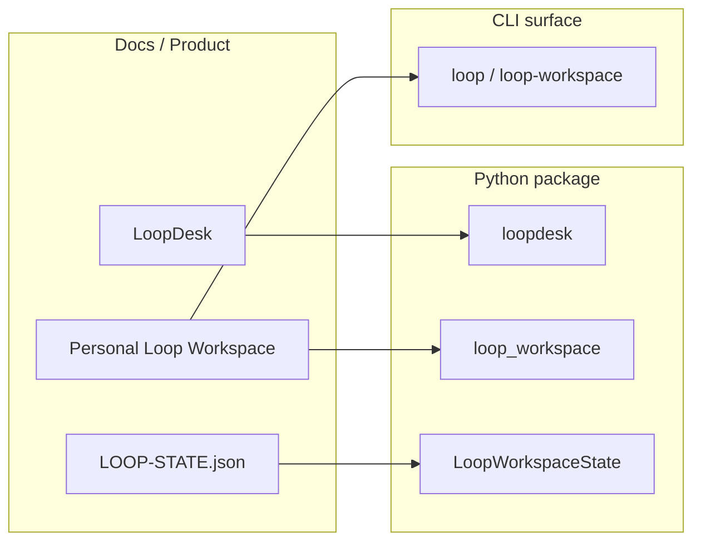

# Risk Handling Plan — LoopDesk v0.1 Personal Loop Workspace

> Status: ready for review
> Date: 2026-07-07
> Owner: product/engineering
> Decision: approve the cuts and execution gates below before starting Task 1-10 in `docs/plans/2026-07-07-loopdesk-implementation-plan.md:13`.

## 1. Context

- Product direction, competitive review, architecture, PRD, and v0.1 plan are already on disk.
- Relevant references: `docs/decisions/product-strategy.md:8`, `docs/prd/personal-loop-workspace.md:73`, `docs/plans/2026-07-07-loopdesk-implementation-plan.md:5`.
- This document is the execution safeguard for the current risk: **LoopDesk still carries many unnecessary legacy functions, and naming is not unified**.
- This plan also satisfies the project rule that research, analysis, and decision deliverables must be persisted to disk before implementation continues.

## 2. Problem Framing

`src/loopdesk` currently behaves like a general-purpose multi-channel agent runtime, not like the minimal personal loop workspace defined for v0.1.

Observed bloat and naming noise include:
- **Messaging channel breadth**: Slack, Telegram, Discord, DingTalk, WeCom, Matrix, QQ, and websocket adapters plus channel management CLI/views.
- **Legacy state/session layers**: `dist/workspace_state`, `session`, `memory`, `sessions`, `diagnostics`, `replay`, `cron`, and multiple GUI/CLI surfaces.
- **Broad skill/media catalogs**: 129 bundled skills and 24 experimental skills covering video, music, paper writing, PDF, voice, and media pipelines.
- **Unclear brand/term boundaries**: "LoopDesk" vs `loopdesk`, `session` vs loop workspace, `squilla_router` vs router config, and `workspace-state.json` vs `LOOP-STATE.json`.

If implementation starts without controls, the likely failure modes are:
- v0.1 becomes a rebranded LoopDesk full stack instead of a focused personal loop workspace.
- developers misuse session/loop terminology.
- context handoff between Claude Code, Codex, Codebuddy, Trae, and Gemini stays trapped in legacy chat/session semantics.

## 3. Risk Inventory

| ID | Risk | Impact | Likelihood |
| --- | --- | --- | --- |
| R1 | v0.1 scope leaks into legacy surfaces | high | high |
| R2 | messaging/IM channels dominate the integration story | high | medium |
| R3 | `session` and `loop workspace` are used interchangeably | high | high |
| R4 | brand/terms drift between docs, code, CLI, and Web UI | medium | high |
| R5 | skills/media catalogs distract from personal loop core | medium | medium |
| R6 | old `dist/workspace_state` is mistaken for the new source of truth | high | medium |
| R7 | router/tokenjuice/old runtime internals are exposed as product features | medium | medium |

## 4. Control Strategy

### 4.1 Cut the legacy surface; keep the reusable runtime

Treat `src/loopdesk` as a **runtime library**, not as the v0.1 product surface.

- **Do not add v0.1 CLI commands, Web UI views, onboarding flows, or docs pages for:**
  - channels, messaging, IM delivery, or channel onboarding
  - cron/scheduling as a primary personal-loop feature
  - diagnostics/replay/migration tooling unless needed for loop debugging
  - media pipelines, PDF/PPTX/voice/video skills, and broad bundled-skill discovery
  - named durable agents, multi-user roles, or team governance
- **Reuse internally only:**
  - gateway, approvals, permissions, SQLite persistence, compaction helpers, cost tracking, provider layer, MCP surface, and safe tool runtime.

References: `docs/decisions/product-strategy.md:61`, `docs/decisions/product-strategy.md:69`, `docs/prd/personal-loop-workspace.md:86`, `docs/plans/2026-07-07-loopdesk-implementation-plan.md:7`.

### 4.2 Define the v0.1 public surface explicitly

Use a **v0.1 Surface Contract** before coding.

- **In scope for public docs, CLI, Web UI, README, and release notes:**
  - `LOOP-STATE.json`
  - memory, skills, artifacts, worktrees under the project/workspace boundary
  - loop commands for create/read/update/resume/export
  - MCP adapter first, ACP adapter second
  - local CLI and minimal local Web UI for loop inspection and approvals
- **Out of scope for public v0.1 surface:**
  - channels, IM bots, cron/scheduling, diagnostics-first flows, media-generation skills, and team features
- If a legacy surface is useful later, move it to **v0.2 or internal-only** and document that decision explicitly.

References: `docs/decisions/product-strategy.md:16`, `docs/prd/personal-loop-workspace.md:120`, `docs/plans/2026-07-07-loopdesk-implementation-plan.md:92`.

### 4.3 Add a boundary layer between legacy and new code

Do not mix old chat/session concepts directly into the new loop workspace layer.

- Add `src/loopdesk/loop_workspace` as the **owned v0.1 surface layer**.
- If legacy code is reused, wrap it behind **adapter or facade modules**, and keep legacy imports out of public loop workspace exports.
- If the existing `session` layer is needed for memory/loop workspace continuity, treat it as **internal runtime support**, not the loop product model.
- Do not expose `dist/workspace_state` as the loop source of truth.

References: `src/loopdesk/dist/workspace_state.py:1`, `tests/test_dist/test_workspace_state.py:1`, `docs/plans/2026-07-07-loopdesk-implementation-plan.md:16`.

### 4.4 Unify naming before or alongside Task 1

Do not build new modules with inconsistent naming.

Naming rules:
- `LoopDesk` = project/brand/docs title
- `loopdesk` = Python package
- `loop_workspace` = new v0.1 package
- `LOOP-STATE.json` = portable task state file
- `LoopWorkspaceState` = portable state model
- `loop` or `loop-workspace` = CLI command namespace
- `session` = existing runtime/chat history semantics, not the new product boundary
- `squilla_router` = legacy runtime implementation detail unless later renamed to generic routing
- `workspace-state.json` = legacy install inventory; do not reuse for personal loop state

References: `docs/decisions/product-strategy.md:64`, `docs/features/core-feature-list.md:1`, `docs/architecture/personal-loop-workspace.md:96`, `docs/plans/2026-07-07-loopdesk-implementation-plan.md:103`.

### 4.5 Trim the skill/media surface to the personal loop core

The current skill inventory is far beyond a minimal personal-loop launcher.

- **v0.1 skills support:**
  - author, inspect, list, and run personal workflow skills
  - meta-skills for loop workflows such as research-to-decision, code-review, daily brief, and stack-trace workflows
- **Explicitly defer or remove from v0.1 surface:**
  - advanced dubbing, music/singing, voice clone/conversion/over studios
  - video script, subtitle burner, video merger, still animator, Seedance prompt skills
  - paper authoring pipelines, PDF/PPTX/DocX/Xlsx publishing suites
  - short-drama, kid project planner, job-search pipeline, weather, travel planner

If bundled skills remain in the repository, move them into an **optional legacy skills folder** and do not load them by default in v0.1.

References: `src/loopdesk/skills/bundled`, `src/loopdesk/skills/exp`, `docs/features/skills.md`, `docs/features/meta-skills.md`.

### 4.6 Keep messaging/channels behind an explicit opt-in gate

Even if channels remain in the repo for internal reuse, do not let them become the v0.1 launch story.

- Default channel setup flow must not appear in first-run docs or CLI guidance.
- If an adapter bridge is needed later, implement it as an **optional plugin**, not core.
- Revisit channels only after loop workspace, MCP adapter, memory, and maker/checker loop are stable.

References: `docs/README.md:40`, `docs/channels.md:1`, `docs/features.md:3`, `src/loopdesk/channels`.

### 4.7 Separate "token-efficient agent runtime" from "personal loop workspace"

The current README/product docs still describe LoopDesk as a token-efficient multi-surface agent runtime.

- Public docs and CLI help text should lead with **personal loop workspace**, not legacy token-efficiency or channel breadth.
- Keep legacy runtime strengths available as internal capability statements, not headline product copy.

References: `README.md:1`, `README.product.md:3`, `docs/decisions/product-strategy.md:59`.

## 5. Execution Gates

Run these gates before and during v0.1 implementation.

| Gate | Check | Pass Criteria |
| --- | --- | --- |
| G1 Scope approval | Review this risk plan and `docs/prd/personal-loop-workspace.md:73` | No unresolved objections to legacy-surface cuts |
| G2 Naming baseline | Agree on the naming rules in Section 4.4 | No new v0.1 module uses `session`, `workspace-state`, or legacy `dist` terminology as its public name |
| G3 Surface contract | Publish a short `v0.1 public surface` list in docs | Legacy channel/skill/scheduling docs are marked out of scope or moved out of the v0.1 user path |
| G4 Boundary modules | Start Task 1 with `src/loopdesk/loop_workspace` as the public boundary | No loop workspace API imports channel adapters, cron, or legacy skill catalogs directly |
| G5 State file clarity | Use `LOOP-STATE.json` only for loop workspace state | No code path writes loop task status into `dist/workspace_state` or chat session files |
| G6 Docs/CLI consistency | Every new v0.1 doc/CLI surface mentions loop workspace first | No new user-facing copy returns to "multi-channel agent runtime" as the primary description |
| G7 Cut-list enforcement | During Task 1-10, any new legacy-surface work is explicitly approved | No unapproved expansion into channels, video/audio/media skills, or team features |
| G8 Re-validation | After each major task | Run targeted tests for loop workspace only, plus a grep review for accidental legacy coupling |

Suggested grep gates:
- fail if new `loop_workspace` imports `loopdesk.channels`
- fail if new `loop_workspace` imports `loopdesk.scheduler` for user-facing loops
- fail if new public docs mention `channels add` in the v0.1 quickstart

## 6. Follow-Up Actions

1. **Approve this plan before Task 1.**
2. **Add a short naming decision doc or glossary update** aligned with Section 4.4.
3. **Move or hide legacy docs** that conflict with v0.1 rather than deleting them unilaterally.
4. **Defer channel/skill/scheduling surface decisions** to a post-v0.1 backlog.
5. **Re-evaluate router/tokenjuice exposure** after loop workspace and MCP adapter are stable.
6. **Use this plan as the review checklist** in `docs/plans/2026-07-07-loopdesk-implementation-plan.md:1`.

## 7. Assumptions

- The reusable runtime can stay under `loopdesk`, but the **product** is now the personal loop workspace.
- Legacy code may remain temporarily in the repository if it is hidden from docs, CLI, and Web UI.
- Naming unification is treated as a **prerequisite** for clean implementation, not a later cleanup task.
- If the team wants to preserve LoopDesk as a general runtime product, the personal loop workspace should be developed in a clearly separated module or package boundary to avoid further naming and scope confusion.
