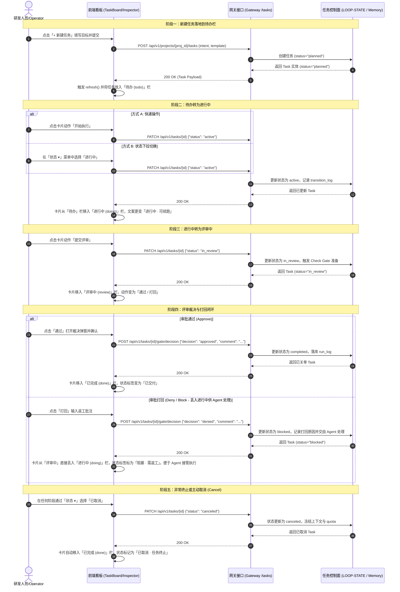

# LoopDesk WebUI 详细设计规格说明书（v2.0 完整版）

> **文档版本**：v2.0.1  
> **更新时间**：2026-09-16  
> **对齐基准**：`docs/prd/loopdesk-prd-v2.0.zh.md` (§9.11 40个标准组件)、Ardot 设计稿（画布节点 `37:1` / `37:6` / `37:11` / `2:227`）、10 屏交付形态与当前 `frontend/src/` 实现。  
> **状态**：通过 PRD 与前端双向审计，冻结技术与交互契约。

---

## 1. 架构定位与核心设计原则

LoopDesk 是面向独立开发者的个人循环工作区（Personal Loop Workspace），WebUI 遵循 **Codex 桌面端原生三栏范式** 与 **任务一等公民（Task-first）** 理念：

1. **任务一等公民（Task-First）**：主视图为工程任务/循环（Task/Loop）看板与详情，彻底摒弃通用聊天窗口（Chat-first）概念；会话仅作为任务的执行子流。
2. **极简渐进暴露（Progressive Disclosure）**：
   - **Level 1（默认/普通开发者）**：仅感知任务、阶段进度、状态芯片、交付物、审查包与审批门（Approve/Deny）。
   - **Level 2（按需展开）**：查看 Checkpoint、Diff、测试执行用例、上下文包。
   - **Level 3（底层/排错模式）**：查看原始 `LOOP-STATE.json`、Handoff 包、RunLog 与完整事件流。
3. **闭环可审阅性（Reviewable Loop）**：任何代码变更均必须关联 Failing Test 凭据、Review Packet 8 段契约与明确的审批门径。
4. **设计系统严谨对齐**：使用设计系统 Token（Neutral、Green、Amber、Red、Purple），严禁破坏性自定义边框（no custom border hacking），保证 `npm run build` 产物轻量受控（<250 kB）。

---

## 2. 全局信息架构（Codex 三栏恒定布局）

```
┌────────────────────────────────────────────────────────────────────────────────────────┐
│ TopBar: [LoopDesk Logo] [项目选择器: LoopDesk 核心 ▾] | [搜索 ⌘K] [团队资产] [设置] [帮助]  │
├──────────────┬──────────────────────────────────────────┬──────────────────────────────┤
│ 左栏 (240px) │ 中栏 (flex: 1, min-w: 640px)              │ 右栏 (380px, 可折叠)         │
│ Navigation   │ Main Workspace (Task Board / Detail)     │ Context & Inspector          │
│              │                                          │                              │
│ • 新建任务   │ ┌──────────────────────────────────────┐ │ ① 任务状态 (card.state)      │
│ • 任务 (看板)│ │ 列1: 待办  列2: 执行中  列3: 待审批  │ │   - 状态芯片 / 六阶段 Stepper │
│ • 状态分组   │ │ [Card]   [Card]    [Gate 阻断]  │ │   - 两段式处置 / 路由验证      │
│ • 待审批红点 │ │                     [Card]     │ │ ② 详情展开 (card.detail)     │
│ • 空间与设置 │ └──────────────────────────────────────┘ │   - Agent / Handoff / Diff   │
│              │ (点击卡片展开 C5: 任务详情与 Review 包)  │ ③ 交付物清单 (card.state)    │
│              │                                          │   - 内链(锚定) + 外链(PR/CI) │
│              │                                          │ 尾部: 预算与配额 (Spend/Cap) │
└──────────────┴──────────────────────────────────────────┴──────────────────────────────┘
```

---

## 3. PRD §9.11 40 个标准组件详细规格

### 3.1 左栏导航组件群 (L1 - L6)
- **L1 项目切换器 (Project Selector)**：支持切换本地绑定的 Git 仓库与 LoopDesk 空间，展示项目活跃任务数；触发下拉选择。
- **L2 状态分组列表 (Status Filter Nav)**：快捷按 `全部任务`、`进行中`、`待审批 (带红点)`、`已完成` 过滤中栏看板。
- **L3 新建任务主按钮 (Primary Action)**：固定在左栏顶部，高亮样式，快捷键 `⌘N`，点击唤起 C4 新建任务模态窗。
- **L4 团队资产快捷入口 (Marketplace Link)**：一键路由至团队规则、命令、技能、MCP 资产市场。
- **L5 审批门红点提示 (Gate Badge)**：动态计算处于 `blocked_on_gate` 的任务总数，展示 Amber/Red 数字角标。
- **L6 侧边栏折叠控制器 (Collapse Rail)**：支持收起为 56px 紧凑图标栏，释放水平屏幕空间。

### 3.2 中栏看板与任务流组件群 (C1 - C7)
- **C1 四列状态看板 (Kanban Board)**：
  - `待办 (Backlog)`：排队中、未分派或就绪待取的任务。
  - `进行中 (In Progress)`：Agent 正在分析、TDD 编码或运行测试的任务。
  - `待审批 (Pending Approval / Gate)`：触发 P0/风险变更或需人工授权的主干阻断门（Amber 态势）。
  - `已完成 (Completed)`：已合并 PR、通过全量回归或归档的任务。
- **C2 任务卡片 (Task Card)**：
  - 核心字段：任务编号（如 `#102`）、标题、所属项目、模板标签、主责 Agent 头像、成本消耗、耗时、当前阶段。
  - 交互：**单选选中**（驱动右栏更新上下文，保持中栏不变）；**双击或点击「查看详情」**（中栏转入 C5 任务详情页）。
- **C3 筛选与搜索工具条 (Board Filter Bar)**：支持模糊搜索标题、按 Agent 筛选、按模板分类、按标签过滤。
- **C4 模板化新建任务面板 (New Task Modal)**：
  - **项目归属与模式感知（Project Selector & Mode Badge）**：
    - 下拉选择归属项目，展示模式标记（`[Local]` 本地工作区 vs `[Remote]` 远端 Git 仓库）；
    - 支持点击「+ 关联新项目」，提供本地文件夹路径绑定或 Git URL 输入。
  - **2×2 模板卡片选择**：
    - `issue-fix`：缺陷修复与 TDD 闭环（绑定 Issue 链接/编号、重现要求）。
    - `pr-commit`：特性交付与 PR 提交（分支名、目标分支、变更说明）。
    - `auto-research`：技术方案调研与架构分析（调研深度、输出报告格式）。
    - `free-loop`：自由意图循环任务。
  - **远端任务与 MCP 前置拦截 (Pre-flight Guardrail MUST)**：
    - 当选择远端项目，或任务模板指定接入外部工单（JIRA / Plane）时，系统自动探测对应 MCP 连接状态；
    - **未挂载强拦截**：若 JIRA/Plane MCP 未连接，面板渲染琥珀色阻断卡片，禁用「开始任务」按钮，并高亮展示「去配置连接器 ➔」一键跳转至 `SettingsMcp`；
    - **挂载就绪**：激活 Issue 智能匹配搜索，拉取归属于当前开发者的待办工单。
  - **高级选项（可折叠）**：模型选择、Token 预算上限、超时阈值、指定 Agent。
- **C5 任务详情全景视图 (Task Detail View - 第 10 屏)**：
  - **任务头部 (Header)**：返回看板面包屑、任务编号、标题、生命周期状态芯片、快捷操作（继续/暂停/终止/重试）。
  - **评审包 8 段契约 (Review Packet)**：
    1. 动机 (Motivation)
    2. 改动思路 (Approach)
    3. 具体改动文件与行级索引 (Touched Symbols & Lines)
    4. 对主干的风险评估 (Risk Assessment)
    5. 整体评审结论 (Overall Verdict: APPROVE/REVISE)
    6. 机器验证凭据 (Machine Validation Receipt)
    7. 阻断门禁状态与理由 (Gate Status & Rationale)
    8. 英文执行结论 (English Verdict)
  - **代码变更与 Diff 浏览 (Interactive Diff Viewer)**：展示变更文件树与逐行 Diff，支持关联查看。
- **C6 简化阶段指示器 (Compact Stepper)**：面向普通用户的四步流转（分诊 → 执行 → 验证 → 完成）。
- **C7 状态占位组件 (Board States)**：涵盖看板空状态（Empty State + 推荐模板引导）、骨架屏加载（Skeleton Loading）与接口错误兜底卡片（Error Retry Card）。

### 3.3 右栏上下文与核验组件群 (R1 - R8)
采用三段生成模型（依据画布节点 `37:1` / `37:6` / `37:11` / `2:227` 冻结）：
- **R1 任务概览与元数据**：标题、项目、模板、当前 Owner、创建与运行时长。
- **R2 六阶段流程条 (Loop Engineering Stepper)**：
  - 阶段映射：`分诊 (Triage) → 制作 (Maker) → 检查 (Checker) → 升级 (Escalation) → 运行日志 (Run Log) → 停止条件 (Stop Condition)`。
  - 展示当前所在阶段的高亮脉冲与已完成阶段的绿色勾选。
- **R3 成本与预算计量 (Budget & Spend Guard)**：
  - 实时已消耗 Token 数、花费折算（美元/人民币）。
  - 设定上限进度条；当达到 80% 触发黄色预警，超额触发阻断。
- **R4 审批门决策控制台 (Gate Approver Console)**：
  - 阻断原因说明（如：“检测到核心安全配置变更，需要管理员授权”）。
  - 核心操作：**「Approve (放行)」**（录入放行批注并解除阻断）与 **「Deny (驳回)」**（输入整改要求并退回 Maker 阶段）。
- **R5 交互式 Diff 预览 (Sidecar Diff)**：右栏内嵌的轻量变更快照。
- **R6 Agent 状态与接管 (Agent Runtime Status)**：展示当前执行 Agent 的心跳、内存消耗、子会话 ID，支持人工介入接管。
- **R7 动态验证徽标 (Validation Badge)**：展示 Failing Test、Passing Test 与覆盖率凭据。
- **R8 交接包与上下文快照 (Handoff Accordion)**：折叠展示向其他 Agent 或宿主系统交接的结构化上下文。

### 3.4 团队资产市场与设置组件群 (M1 - M8, S1 - S11)
- **M1 - M8 团队资产中心**：
  - 统一展示 `Rules (规则)`、`Commands (命令)`、`Skills (技能)` 与 `MCPs (模型上下文协议)` 资产卡片。
  - 权限分层：普通开发者为只读与“已启用”浏览；Owner/Admin 支持一键安装、版本下发与回滚。
- **S1 - S11 设置面板 (Codex 风格)**：
  - 左侧垂直二级导航，包含：通用、模型管理、Agent 参数、MCP 服务配置、项目与路径、团队权限、外观偏好。

---

## 4. 前后端通讯协议与状态机设计

### 4.1 核心 REST 端点契约 (FastAPI Gateway)

```http
# 1. 任务流操作
GET    /api/v1/projects/{project_id}/tasks          # 获取看板任务列表 (带状态过滤)
POST   /api/v1/projects/{project_id}/tasks          # 新建任务 (基于模板入参)
GET    /api/v1/tasks/{task_id}                      # 获取任务详情 (含 8 段 Review 包与 Diff)
POST   /api/v1/tasks/{task_id}/gate/decision        # 提交审批门决策 (approve / deny)
POST   /api/v1/tasks/{task_id}/actions/{action}     # 控制指令: resume / pause / abort

# 2. 团队资产与配置
GET    /api/v1/projects/{project_id}/assets         # 获取资产市场项目列表
POST   /api/v1/projects/{project_id}/assets/install # 安装/启用指定技能或 MCP
```

### 4.2 实时事件流 (Server-Sent Events: SSE)
- 端点：`GET /api/v1/tasks/{task_id}/events` 或全局广播 `GET /api/v1/projects/{project_id}/stream`
- 消息规范：
  ```json
  {
    "event": "task_phase_changed | gate_blocked | test_verified | token_spend_updated",
    "data": {
      "task_id": "task_102",
      "phase": "checker",
      "gate_status": "blocked_on_user",
      "spend": 12450,
      "message": "Failing test passed; waiting for merge gate approval"
    }
  }
  ```

---

## 5. 任务状态转移模型与 UI 状态机设计

### 5.1 任务状态转移时序与生命周期全景

LoopDesk 任务生命周期围绕**四列看板**（待办 `todo`、进行中 `doing`、评审中 `review`、已完成 `done`）与 **6 个业务底层状态**（`planned`、`active`、`in_review`、`blocked`、`completed`、`canceled`）运转：

```
                    ┌───────────────────────── [取消 canceled] ──────────────────────────┐
                    │                                                                    │
                    ▼                                                                    │
┌──────────────┐ 开始执行   ┌──────────────┐ 提交评审   ┌──────────────┐ 审批通过   ┌──────────────┐
│  待办 todo   │ ────────> │ 进行中 doing │ ────────> │ 评审中 review│ ────────> │ 已完成 done  │
│ (planned)    │           │ (active)     │           │ (in_review)  │           │ (completed/  │
└──────────────┘           │              │           └──────────────┘           │  canceled)   │
       │                   │              │                  │                   └──────────────┘
       │                   │              │                  │ 打回需返工 (blocked)     ▲
       │                   │              │ <────────────────┘                          │
       │                   │ (blocked     │                                             │
       │                   │ 阻塞需返工)  │ ────────────────────── 修复完成重新提交 ────┘
       │                   └──────────────┘
       └────────────────────────────────────────────────────────────────────────────────┘
```

> **状态流转关键原则**：
> 1. **「评审中」栏（用于决策）**：只承载待人工或规则决裁的任务（`in_review`），卡片动作专注于「通过 / 打回」；
> 2. **「进行中」栏（用于 Agent 执行与处理）**：承载正在执行的任务（`active`）以及被裁决打回后**「阻塞需返工」（`blocked`）**的任务，便于 Agent 挂载上下文、定位测试失败并直接开展编码与修复。

#### 5.1.1 状态与看板栏映射及业务徽标规范

| 业务状态 (`status`) | 看板栏位 (`TaskColumnId`) | 内部卡片态 (`CardState`) | 卡片状态标签文案 | 颜色标识 | 可用交互动作 |
| :--- | :--- | :--- | :--- | :--- | :--- |
| `planned` | `todo` (待办) | `todo` | `待办 · 未启动` | 蓝色 (`--c-blue`) | `开始执行` (转 active)、`状态 ▾` 下拉 |
| `active` | `doing` (进行中) | `handoff` | `进行中 · 可续跑` | 翡翠绿 (`--c-emerald`) | `提交评审` (转 in_review)、`状态 ▾` 下拉 |
| `blocked` | `doing` (进行中) | `handoff` | `阻塞 · 需返工` | 琥珀黄 (`--c-amber`) | `提交评审` (修复后重新送审)、`状态 ▾` 下拉 |
| `in_review` | `review` (评审中) | `gate` | `评审中 · 等待确认` | 琥珀黄 (`--c-amber`) | `通过` (转 completed)、`打回` (转 blocked 并丢回进行中) |
| `completed` | `done` (已完成) | `delivered` | `已交付 · run log 完整`| 灰色 (`--c-ts`) | 终态，只读查看，支持重新激活 |
| `canceled` | `done` (已完成) | `delivered` | `已取消 · 任务终止` | 柔和灰 (`--c-tm`) | 终态归档，移入已完成栏 |

---

### 5.2 任务状态转移时序图 (Mermaid Sequence)

以下时序完整刻画了用户、前端看板 (TaskBoard)、网关状态路由 (Tasks API) 以及后端持久化存储 (LoopWorkspace State) 之间的调用闭环：



---

### 5.3 UI 容灾与交互边界

1. **状态防抖与乐观更新机制**：
   - 用户触发状态变更后，UI 乐观移动卡片并锁定动作栏；待网关返回或 SSE 下发确认后解除锁定。
   - 若网关返回错误（如非法的状态跃迁），卡片弹回原列并展示 Toast 告警提示。
2. **顶栏布局精简规范**：
   - 移除原无实际检索逻辑且破坏三栏紧凑布局的「搜索框」组件。
   - 顶栏专注保留「工作区/项目上下文快速选择器」、「Agent 运行健康指标」及「用户档案」三大核心控制元。
3. **网络断连与心跳重连**：
   - SSE 连接中断时，顶部展示“正在重新连接状态流...”轻量提示，采用指数退避算法（1s, 2s, 4s... 30s）重试。
   - 保留上次已接收的本地状态缓存，不可闪烁为全屏白屏。
