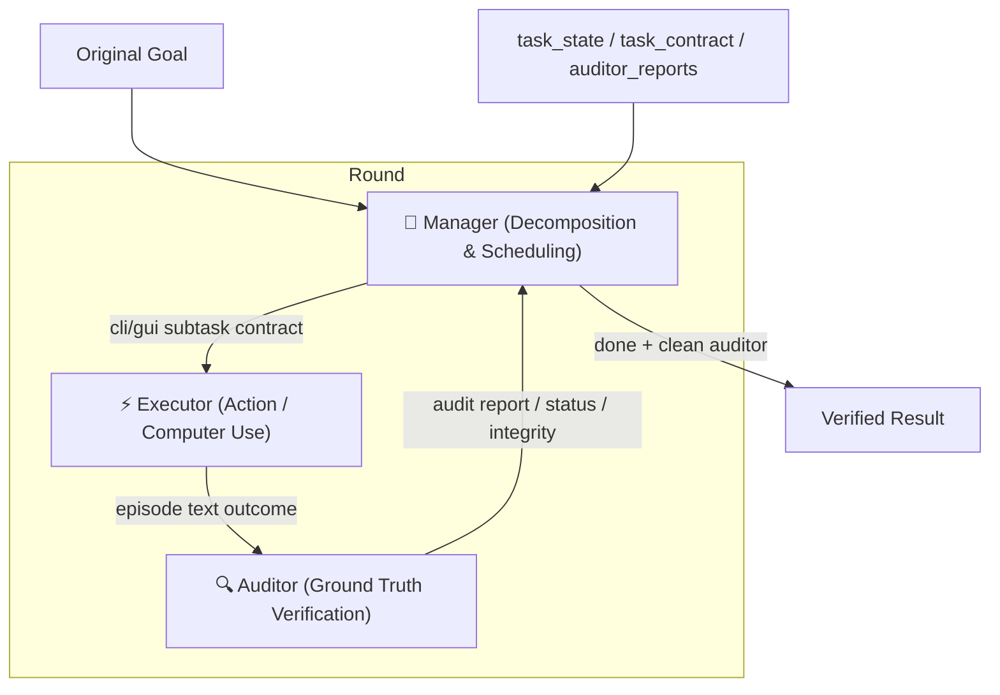

# Competitive Intelligence: AMAP-ML/LongHorizon-Harness

- **Repo**: [github.com/AMAP-ML/LongHorizon-Harness](https://github.com/AMAP-ML/LongHorizon-Harness)
- **Authors**: Ziyu Ma, Hailang Huang, Shun Zou, Yong Wang, Shidong Yang, Yiming Hu, Fei Wei, XiangXiang Chu (AMAP-ML team)
- **License**: MIT
- **Language**: Python 3.10+ (CLI & Web API) + React (Frontend dashboard)
- **Version**: v0.1.4 (actively developed, released August 2026)
- **ArXiv Paper**: [arxiv.org/abs/2608.01964](https://arxiv.org/abs/2608.01964) (reached #1 on Hugging Face Daily Papers, August 2026)
- **Tagline**: "Loop Engineering for Computer-Use Agents"

## 1. What Is LongHorizon-Harness

LongHorizon-Harness 是一套设计严简的 **面向 Computer-Use Agent 的 Loop Engineering (循环工程) 执行与评估框架**。它并不训练新模型，也不替换现有的 Agent 系统，而是通过配置将现有的端到端 Agent（如 Claude Code 或 Codex CLI）连接起来，形成一个能够进行跨应用（桌面应用 + 终端 CLI）、多步规划、持续执行、并在异常及上下文刷新后能够优雅恢复（Checkpoint-Recover）的“长期任务执行闭环”。

其核心解决的核心痛点有三：
1. **历史失真与漂移**：长程任务中，直接多轮对话的历史越长，Agent 处理起来越困难，容易“忘记”最初目标或在中间产生逻辑漂移。
2. **缺乏独立验收机制**：传统 Agent 完成任务即报告自己“搞定”，没有独立的、强制性的环境状态审计和约束验收。
3. **进度丢失与无限空转**：网络断连、任务出错或上下文超限会导致整条轨迹重头开始，或者在没有进展时依然无谓地燃烧 Token。

## 2. 三角色管理闭环 (Orchestrated Multi-Role Loop)

LongHorizon-Harness 将长程执行循环拆分为三个各司其职的角色，在每轮次（Round）中交替流动：



### 1) 🧭 Manager (管理者)
- **职责**：负责拆解目标、定义每步的契约、并根据本轮以前的所有审计报告安排下一个子任务是走 `gui` （操作桌面 App/浏览器）、`cli` （终端/文件/运行脚本），或者报告 `done`、`blocked`、`ask`。
- **关键规则**：Manager **绝对不能使用终端或修改文件**。为防止上下文无限增长，它**永远不会接收 Executor 的原始执行历史**。它所掌握的唯一“事实源”是它本人的 `task_state`（持续维护的任务状态）、`task_contract`（上一轮的任务契约）和由 Auditor 出具的自然语言审计报告。

### 2) ⚡ Executor (执行者)
- **职责**：接下 Manager 定义的 CLI 或 GUI 子任务，在**全新的上下文（Fresh Context）**中启动，并操作具体的电脑界面或命令行来完成子任务。
- **关键规则**：单次 Executor 运行完成后，其上下文即被销毁（Discarded），仅向下一角色（Auditor）提供它的自然语言输出摘要。

### 3) 🔍 Auditor (审计者)
- **职责**：在子任务执行完后，独立、无偏见地根据当前的文件、系统接口、图像（GUI 截图）和测试日志进行状态验收，以确认 Executor 究竟完成了什么，没完成什么。
- **关键规则**：为了保证“只读”，Auditor 在 C‍laude Code 的配置下被过滤掉 `Write`, `Edit`, `NotebookEdit` 工具，在运行前/后对工作区进行 **`WorkspaceSnapshot` 文件哈希快照与差分对比 (diff)**。一旦 Diff 发现 Auditor 对工作区进行了物理篡改，即判定为 `Integrity: violation` 并不承认其审计结果。

## 3. 严格的审计报告契约与解析机制

Auditor 产生的所有审计报告必须以严格的三行控制头（Control Headers）开头，如果不满足，Harness 将自动将其退回重做或判定为阻断错误（Format Repair）：

```text
Status: complete | incomplete | blocked
Integrity: clean | suspect | violation
Contract audit: aligned | unknown | needs_revision | invalid
```

解析与约束机制 (`parse_audit_report`) 会强制实行安全性门禁保护：
- 若控制头缺失或异常，Harness 启动 `format_repair_agent`（花费小额配额）进行报告格式修复。
- 若 `Integrity` 状态为 `violation`（篡改了工作区）或 `Contract audit` 状态非 `aligned`（与契约不符），即使 Auditor 自己写了 `Status: complete`，Harness 也会强行覆盖 `status` 为 `incomplete` 判定执行失效重新回滚。
- 只将通过独立审计且控制头完全正常的步骤设为 `Checkpoint`。失败的内容只作为下轮 Manager 的证据，坚决不成为递进进度。

## 4. Web API & Dashboard 工作台

LongHorizon-Harness 提供了一个利用 FastAPI 和 React 实现的本地网页工作台 `lh-harness web` 或 `lh-harness run --dashboard`：

- **React Dashboard UI**：实时显示每个 Round 的 Plan（Manager 发起的规划）、Execution（Executor 执行动作）、Audit（Auditor 审计到的证据与控制头状态）和 Rework（若失败，对失败原因的解析）。
- **人工干预门禁 (Human Gate)**：在 Round 结束时，可以通过配置调用 `human_hook` 在浏览器上暂停任务：
  - 当整组 Episode 完成或达到最大轮次超配时；
  - 发生 Manager 阻断 (`blocked`) 或需要澄清 (`ask`) 时；
  - 经历 `repeated_failure`（如连续 Plan 或 Executor 出错超过指定阈值）时；
- 面板支持操作员进行 `continue`（可动态追加 Round 配额并注入人工指令 `instructions`）或 `stop` 中断。

## 5. 项目结构与主要 Crate/Module

- `lh_harness/cli.py`：CLI 控制层入口，命令行操作 doctor, run, dashboard, web 等命令。
- `lh_harness/types.py`：定义运行的核心数据结构如 `HarnessConfig`, `ManagedRound`, `AuditReport`, `EpisodeResult` 等。
- `lh_harness/manager.py`：整个框架的最核心状态循环和进程拉起调度实现（`run` & `_run_impl` 函数）。
- `lh_harness/auditor_agent.py`：负责调用 Auditor Agent 并解析控制流/控制头信息，管理格式修复。
- `lh_harness/adapters/`：多 Agent 后端的胶水和适配器，将 C‍laude Code, Codex CLI 映射为统一的 `CommandAgentAdapter` 并以特定环境变量和指令启动他们。
- `lh_harness/adapters/claude_permissions.py`：针对 C‍laude Code 的深度角色权限隔离，禁用特定写工具，以及实现 `snapshot_workspace` 和 `workspace_snapshot_diff` 文件级只读审计守卫。
- `lh_harness/dashboard/` & `lh_harness/webapi/`：本地后台 FastAPI 服务、规则引擎、以及审批状态通道。

## 6. 与 LoopDesk 的关系与对比分析

### ⚠️ 高度一致的概念与理念
LoopDesk 在其 golden rules 和 product positioning 中反复提到的**Loop 运行体系、状态持久性、多工具/Agent 保持上下文一致、以及 Maker/Checker 拆分防御**等一系列顶层设计，与 LongHorizon-Harness 的细节设计极为相似，是一次极好的同行实践比对：

| 维度 | LoopDesk v0.1-v0.2 | LongHorizon-Harness | 备注 |
|------|--------------------|---------------------|------|
| **核心机制** | Loop Engineering 运行机制 | Loop Engineering 面向 CLI/GUI | 理念源流一致 |
| **状态载体** | `LOOP-STATE.json` 持久本地状态 | isolated run-dir: `report.json` + `events.jsonl` | 均采用本地文件驱动 |
| **工具映射** | MCP-first, ACP-second 协议适配隔离 | `AgentAdapter` 提供统一 CLI Wrapper | LH-Harness 外接 CLI, LoopDesk 桥接 MCP/ACP |
| **分工协作** | Maker / Checker split (Maker 做，Checker 检) | Manager / Executor / Auditor 三角色 | 结构基本对称；LH 将调度(Manager)独立出来 |
| **审批门禁** | Stop conditions / Cost & Safety controls | `human_hook` / `repeated_failure` rules | 处理空转和安全的思路高度重合 |
| **对话长度** | session continuity 保持，上下文控制 | Discard executors, build context from Audit alone | LH 在控制上下文大小上做得更为决绝 |
| **用户工作台** | 规划中的 Local Web UI 面板 | 本地 FastAPI / React Dashboard Web | LoopDesk 规划中的前端可借鉴 LH 的可视化 |

### 核心差异点

1. **解决场景不同**：
   - **LoopDesk**：聚焦于**个人独立开发者**的一体化开发上下文保持。通过 MCP/ACP 充当 Claude Code/Codex 等主流工具的“插件/适配器“，在背后静默同步文件修改、对话记忆和 skills。
   - **LongHorizon-Harness**：聚焦于 **“Computer-Use” GUI/Terminal 综合长程任务的完全托管**。它本身是一个调度顶层引擎，它去以 subprocess 形式拉起 Claude Code 或 Codex CLI 去干活、去审计，最终跑数十小时得到结果。
2. **三角色 vs Maker-Checker**：
   - **LoopDesk** 的 Maker/Checker 属于执行层分工（生成代码和验收测试）。
   - **LH-Harness** 多出了一层**独立的 Manager 调度层**。这对于涉及 GUI (如“在浏览器和 Excel 之间跨软件干活”) 的场合非常必要，因为除了 coding 本身，还存在着子步骤拆解、屏幕交互归纳、以及多角色切换决策的调度开销。
3. **上下文管理差异**：
   - **LoopDesk** 试图通过 memory 和 session 优化，保证大模型开发时的知识连续性：Agent 在修改同一个 Repo。
   - **LH-Harness** 选择在每一个 Step 执行完后，**主动扔掉 Executor 的过程历史**，重新在新 Sandbox (Fresh context) 里只带上 Auditor 生成的“经过审计的状态总结 (Facts)”。这种做法完全防止了历史冗余导致的上下文超限和长期发散。
4. **只读审计保护**：
   - **LH-Harness** 为防止 Auditor 瞎混淆或者暗中做假，采用了物理级 `WorkspaceSnapshot` 对比。即使大模型用 Bash 偷偷跑了 `sed` 等修改，也无法蒙混过关。这是极其偏执且精美的安全保障。

## 7. LoopDesk 可借镜/可吸收的设计思路

1. **Manager + Maker/Checker 管理模式的引入**：
   对于 LoopDesk 的复杂工作（需要跑数个 Episode 的重型功能实现），如果单一 AI 同时做规划和开发极易失控。可以借鉴其将 **决策/调度 (Manager)** 与 **实际开发 (Maker)** 以及 **独立测试 (Checker/Auditor)** 进行三头分离，且 Manager 充当 read-only 的大脑角色，防止对话历史过多带来污染。
2. **完全扔掉 Execution History 的上下文限制法**：
   如果 AI 开发长程任务时，频繁报错并自我修复，前几次失败的 shell stack 和大段报错很快会把 Context limit 塞满。可借鉴 LH-Harness：每一步执行完毕，仅把 Checker 证明有效的成果记录（在 LoopDesk 里可为 `artifacts` 和 `verified_state`）带到下一轮，把 Executor/Maker 本身拉长无用的终端重试历史完全剪枝。
3. **文件哈希快照防污染机制 (`WorkspaceSnapshot`)**：
   LoopDesk 在执行 Checker 运行时（例如用户只想让 AI 审计某段代码而不可有变动），可以直接复用 `WorkspaceSnapshot` 进行文件哈希监听，物理防范 AI 越权篡改。
4. **Turn-based 规划卡片式的 Card Feed 视觉呈现**：
   LoopDesk Web UI 在做人机共协可视化时，相比于复杂的 CI 视图或大片终端流，可以用 **"Plan -> Execute -> Audit -> Decision"** 的多 Round 卡片瀑布流展示，每步附带其验收头（Status、Integrity、Aligned）评估。这也是对非技术管理人员极为友好的展示方式。
